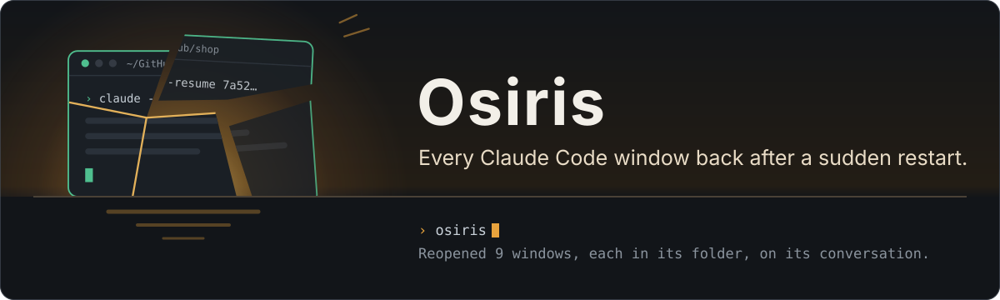

<p align="center">
  
</p>

**Osiris brings back every Claude Code window a sudden restart closed.** The computer froze and had to be restarted,
Windows rebooted for an update, the power went, and ten sessions were open: which conversation was each one on? Run
`osiris`: it lists the windows that were open, and reopens the ones you tick, each in its own folder, on its own
conversation.

- Every window that was open comes back: idle at its prompt or in the middle of a turn.
- Each window resumes with the model, effort and permission mode it had.
- Plain `claude` and [Baton](https://github.com/ntanis-dev/baton) both work: a window Baton started goes back through
  Baton, the others resume in `claude` under the profile they ran on.
- Run `osiris` in Windows Terminal and every window comes back as a tab of that window; from a plain console window,
  each gets a window of its own (see [Where the windows open](#where-the-windows-open)).

Osiris is the Egyptian god of resurrection: torn apart, put back together whole, and brought back.

Needs Node 24 or newer. Built and tested on Windows 11; on macOS and Linux it reopens windows in tmux, or prints the
commands to run. Osiris is an independent project and is not affiliated with Anthropic (see
[Good to know](#good-to-know)).

## Quick start

```sh
git clone https://github.com/ntanis-dev/osiris.git
cd osiris
npm link            # puts `osiris` on your PATH
osiris install      # adds its hooks to ~/.claude/settings.json (--dry-run shows them first)
osiris doctor
```

Claude Code reads hooks when it starts, so the windows open right now are recorded once they restart. From then on,
after a sudden restart:

```sh
osiris              # tick the windows to bring back, then Enter
```

## Everyday use

| Command                  | What it does                                                                                 |
| ------------------------ | -------------------------------------------------------------------------------------------- |
| `osiris`                 | Lists the lost windows and reopens the ones you tick (same as `osiris restore`)              |
| `osiris restore --yes`   | Reopens the ticked ones without asking                                                       |
| `osiris restore --print` | Prints each window's commands instead of opening it                                          |
| `osiris list [--all]`    | The windows Osiris knows: lost, open now, and with `--all` closed earlier or already handled |
| `osiris scan`            | Finds conversations from their transcripts, for windows the hooks never saw                  |
| `osiris doctor`          | Checks the hooks, Baton's profiles and the programs a restore runs                           |
| `osiris install`         | Adds the hooks (`--dry-run` shows the change, `--diff` every line; `uninstall` undoes it)    |

The list takes the whole terminal while you choose, and gives your screen back as it was. `↑` `↓` move, `Space` ticks,
`a` ticks all or none, `Enter` reopens and `q` or `Esc` stops; with the mouse, a click ticks a window, the wheel moves,
and the keys at the bottom are buttons (`OSIRIS_MOUSE=off` leaves the mouse to the terminal, for selecting text). Each
window shows its title, then its folder, whether it goes back through Baton or plain `claude`, when it was last seen,
and "was working" if it was in the middle of a turn. The windows open one after another, a moment apart. Windows you
leave unticked are not offered again (`--all` shows them).

When every window is back, Osiris closes the terminal you ran it in, as if you had typed `exit`: a console window or a
Windows Terminal tab, never an editor's terminal or Claude Code's. If a window could not open, or had to be skipped or
printed, the terminal stays so you can read why; `--keep` keeps it anyway.

`--dry-run` shows what would open and how, `--json` prints data, and `--wt`, `--console`, `--tmux` or `--print` choose
where every window goes instead of the terminal it ran in. `osiris help <command>` shows a command's options.

Every command prints in the same look as Baton's: on a terminal with the wordmark, colours and marks, as plain text
when piped. Set `NO_COLOR` to drop the colours and `OSIRIS_GLYPHS=plain` (or `rich`) to choose the glyphs; the classic
Windows console gets the plain ones by default.

## How it knows what was open

`osiris install` adds a small hook for `SessionStart`, `UserPromptSubmit`, `Stop`, `StopFailure` and `SessionEnd`.
Each time, it updates one file for that Claude Code process: the conversation it is on, its folder, its profile
(`CLAUDE_CONFIG_DIR`), the Baton wrapper that started it, and the terminal it runs in. `/clear` and `/resume` move the
window to the next conversation; exiting ends it. Only interactive sessions count: `claude -p`, the Agent SDK, the IDE
extensions and the desktop app are left alone.

A freeze or a hard reset gives Claude Code no chance to end its session. So when you run `osiris`, a window whose
process is gone and whose session never ended was lost, whether it was idle at its prompt or in the middle of a turn
(those are marked "was working").

A window closed from outside does end its session, but with a reason that exiting at the prompt (`/exit`, Ctrl+C)
never gives: its X, Task Manager's End task, a closed Windows Terminal tab, or Windows closing everything for a restart
or an update. Osiris offers the ones closed together last, and the ones a restart closed (in the hour before the
computer started, with no window seen after them). A window closed earlier, or exited at its prompt, stays closed;
`osiris list --all` shows it.

When the computer restarted, the windows lost in it are ticked and the ones closed since are listed unticked. A lost
window is not offered at all when its conversation already went on somewhere else: open in another window, resumed
later, or moved by Baton to another account.

The title shown is the conversation's `/rename` title, else Claude's own title for it, else its last prompt. A window
that never got a prompt has no conversation to resume yet: it comes back as a new one in its folder.

## Where the windows open

- **Windows, run in Windows Terminal:** every window as a new tab of the window you ran `osiris` in, with the profile
  it had when it ran in Windows Terminal. `--console` opens console windows instead.
- **Windows, run anywhere else:** each window in a console window of its own (`start ... cmd /k`), or, for windows that
  ran in Windows Terminal, as tabs of one new Windows Terminal window. `--wt` puts them all there.
- **macOS and Linux:** a tmux window each, when Osiris runs inside tmux; otherwise the commands are printed.

The shell stays open when Claude Code exits, as it was before. Each window runs a small script from
`~/.osiris/launch`, so no folder name or title is ever quoted through two shells.

## With Baton

Nothing to set up. Baton shares `~/.claude/settings.json` with its account profiles (a link, or a copy it refreshes at
each launch), so the hooks reach every account after Baton's next launch; `osiris doctor` shows each profile. A window
that `baton` started comes back as `baton --resume <id>`, so Baton picks the account again. Without Baton on
your PATH it resumes in `claude` under the profile it was last on.

## Before the hooks were there

`osiris scan` looks at the transcripts instead: conversations written to in the three hours before the computer
started (`--hours 6`, `--until now` or `--until 2026-10-31T14:00` for another span). It is a guess, since a transcript
does not say whether its window was still open, so check the list. It skips conversations from `claude -p`, an IDE or
the desktop app, and ones open in a window now. `--baton` resumes them through Baton.

## Safe by design

- **Nothing leaves your computer.** Osiris reads hook events and transcripts locally and never touches a credential.
- **`~/.claude` changes only through `osiris install`**, which shows what it will do (`--dry-run`), keeps a backup in
  `~/.osiris/backups/<time>/`, and is undone by `osiris uninstall`. Your own hooks, and Baton's, stay as they are.
- **The hooks never get in the way.** They print nothing, finish in a fraction of a second, and never fail a session.
- **Only checked values are passed on.** A model, effort or permission mode that is not a plain word is left out, and
  titles lose every character a shell could read.

## Where Osiris keeps its files

```
~/.osiris/windows/<pid>.json        one per Claude Code process (an older one with the same id: <pid>-<time>.json)
~/.osiris/launch/                   the scripts a restore opens windows with (kept a day)
~/.osiris/install.json, backups/    what osiris install did, and the settings.json it replaced
```

Exited and handled windows are forgotten after two weeks, any window after two months.

## Good to know

Osiris is an independent, community project. It is **not affiliated with, endorsed by, or sponsored by Anthropic**.
"Claude" and "Claude Code" are trademarks of Anthropic, and Osiris uses those names only to say what it works with. It
runs the real, unmodified `claude` (or `baton`) and resumes conversations the way `claude --resume` always does. Osiris
is provided as is, without warranty.

## Development

```sh
npm run check   # syntax
npm run lint    # prettier
npm test        # deterministic: temporary homes under .cache/, no Claude Code needed
```

Osiris has no runtime dependencies.

## License and security

MIT, see [LICENSE](LICENSE). To report a vulnerability, please use GitHub's private vulnerability reporting, as
described in [SECURITY.md](SECURITY.md).
